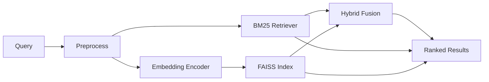
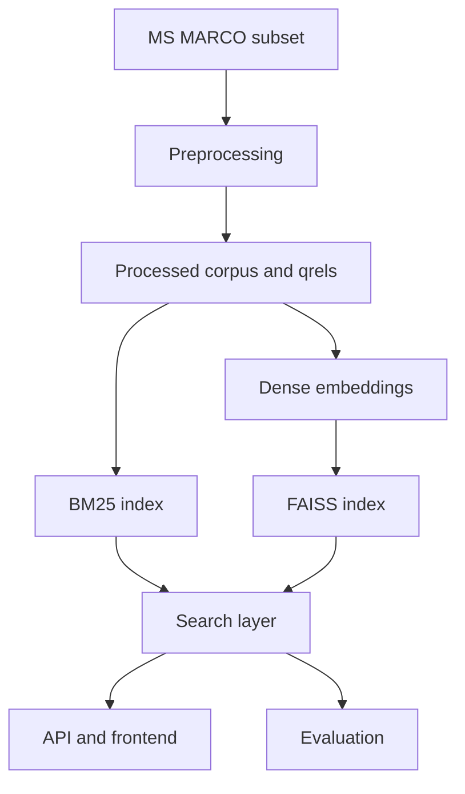

# Semantic Search Engine

A modular information retrieval system that compares lexical, dense semantic, and hybrid retrieval on a real MS MARCO subset.

## Overview

The project focuses on passage retrieval rather than chat or question answering. It ranks candidate passages for a query using three retrieval strategies:

- BM25 lexical retrieval
- Dense semantic retrieval with pretrained embeddings and FAISS
- Hybrid retrieval that combines lexical and semantic scores

The implementation is structured for reproducibility, evaluation, and straightforward extension.



## Motivation

Keyword matching alone is often brittle in real retrieval tasks. Semantic retrieval addresses this by encoding meaning rather than relying only on exact token overlap. The project compares lexical and semantic matching under the same dataset and evaluation setup.

## Architecture

The system follows a layered pipeline:

- Data acquisition and preprocessing
- Index construction for BM25 and FAISS
- Retrieval modules for lexical, dense, and hybrid search
- Evaluation against relevance judgments
- FastAPI backend and static frontend



For a detailed breakdown, see the documentation under docs/.

## Dataset

This project uses the MS MARCO passage retrieval dataset from Hugging Face:

- Dataset: microsoft/ms_marco
- Config: v1.1

The dataset contains:

- queries: user natural-language questions
- passages: candidate passages for retrieval
- relevance judgments: labels indicating which passages are relevant to each query

The project uses a configurable subset through config.yaml so the dataset size can be adjusted for development or larger experiments.

## Installation

1. Create a Python 3.11+ environment.
2. Install dependencies:

```bash
pip install -r requirements.txt
```

3. Activate the environment and confirm the project is importable:

```bash
python -c "import src"
```

## Configuration

All major parameters are controlled by config.yaml.

```yaml
dataset:
  name: msmarco
  max_documents: 300
  max_queries: 50

embedding:
  model_name: "BAAI/bge-small-en-v1.5"
  batch_size: 32

retrieval:
  top_k: 10
  hybrid_alpha: 0.5
```

Modify these values before running data preparation or evaluation.

## Data preparation

### Download the dataset subset

```bash
python scripts/download_data.py
```

### Preprocess the data

```bash
python scripts/preprocess.py
```

This step creates cleaned document and query mappings and stores relevance judgments in data/processed/.

## Index construction

```bash
python scripts/build_index.py
```

This builds the FAISS dense index and saves it under data/index/.

## Running BM25

```bash
python - <<'PY'
from src.data.loader import load_processed_data
from src.retrieval.bm25 import BM25Retriever

documents, _, _ = load_processed_data('data/processed')
retriever = BM25Retriever(documents)
print(retriever.search('what is rba', top_k=5))
PY
```

## Running semantic search

```bash
python - <<'PY'
from src.data.loader import load_processed_data
from src.retrieval.dense import DenseRetriever

documents, _, _ = load_processed_data('data/processed')
retriever = DenseRetriever(documents, model_name='BAAI/bge-small-en-v1.5')
print(retriever.search('what is rba', top_k=5))
PY
```

## Running hybrid search

```bash
python - <<'PY'
from src.data.loader import load_processed_data
from src.retrieval.bm25 import BM25Retriever
from src.retrieval.dense import DenseRetriever
from src.retrieval.hybrid import HybridRetriever

documents, _, _ = load_processed_data('data/processed')
bm25 = BM25Retriever(documents)
dense = DenseRetriever(documents, model_name='BAAI/bge-small-en-v1.5')
hybrid = HybridRetriever(documents, bm25_retriever=bm25, dense_retriever=dense, alpha=0.5)
print(hybrid.search('what is rba', top_k=5))
PY
```

## Running evaluation

```bash
python scripts/evaluate.py
```

This prints a table of retrieval metrics and saves the results under results/. Plots are saved under results/figures/.

### Evaluating RAG

RAG evaluation is separate from retrieval evaluation. Run the context-quality
evaluation with:

```bash
python scripts/evaluate_rag.py
```

This reports Context Recall@5, Context Precision@5, retrieval latency, and
reranking latency, and saves per-query results to
`results/rag_evaluation.json`. To also call the configured Ollama generator:

```bash
python scripts/evaluate_rag.py --generate --limit 10
```

The generated-answer metrics are explicitly lightweight lexical proxies:
`faithfulness_proxy` measures answer-sentence overlap with retrieved context,
and `answer_relevance_proxy` measures query-answer term overlap. They are not
replacements for human or semantic judge evaluation, but provide reproducible
diagnostics without claiming unsupported RAG accuracy.

The generated dataset subset, FAISS index, evaluation outputs, and plots are ignored by git so the repository stays source-only when you push it.

## Starting the API

```bash
uvicorn src.api.server:app --reload --host 0.0.0.0 --port 8000
```

Then call:

```bash
curl -X POST http://localhost:8000/search \
  -H "Content-Type: application/json" \
  -d '{"query":"what is rba","top_k":5,"method":"semantic"}'
```

## Running RAG answers

The `/ask` endpoint retrieves passages with hybrid search, reranks them with the
configured cross-encoder, and generates a grounded answer through Ollama.

Install Ollama, download the configured generator, and start Ollama:

```bash
ollama pull qwen3:8b
ollama serve
```

The API startup loads the configured embedding model, and the first `/ask`
request loads the reranker. These models are downloaded from Hugging Face if
they are not cached. Rebuild the FAISS index after changing
`embedding.model_name`:

```bash
python scripts/build_index.py
curl -X POST http://localhost:8000/ask \
  -H "Content-Type: application/json" \
  -d '{"query":"what is the purpose of the reserve bank","top_k":5}'
```

The response contains the generated answer and the source passages used as
context. `/search` remains available for retrieval-only benchmarking.

## Starting the frontend

Serve the static page in frontend/index.html using any simple web server or open it directly in a browser. The page sends requests to the FastAPI service at localhost:8000.

## Example queries

- what is rba
- how does a neural network work
- what is the purpose of the reserve bank
- benefits of machine learning

## Results

This project does not claim fixed benchmark numbers without execution. Use the evaluation script to generate results from the current configuration and environment.

## Limitations

- Full MS MARCO evaluation can be expensive on CPU-only machines.
- A small subset is recommended for local development and demos.
- Hybrid alpha values are not universally optimal and should be tuned on a validation set.
- The project uses a pretrained embedding model rather than training a custom model from scratch.

## Future work

- apply a formal development/test split
- tune the hybrid alpha parameter and top-k thresholds
- compare multiple embedding models
- add reranking with a cross-encoder for stronger ranking quality
- deploy with a persistent production database and a production frontend stack

## Documentation

Additional project documentation is available under docs/.
