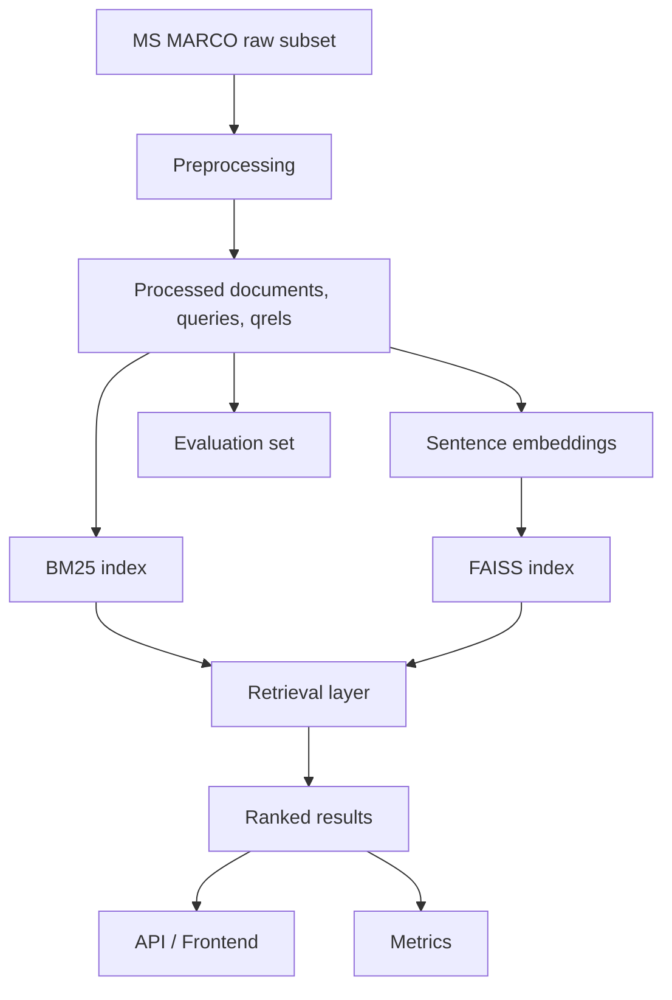
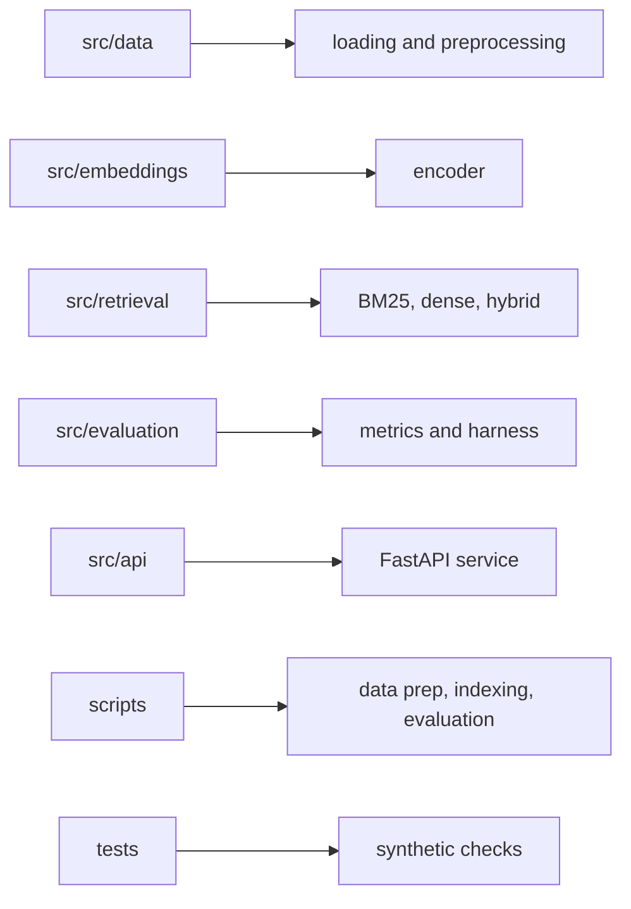

# Architecture

The system is organized as a retrieval pipeline with clear boundaries between data preparation, indexing, retrieval, evaluation, and serving.

## System flow

## Core components

### 1. Data layer

The data layer loads a configurable MS MARCO subset and converts it into a compact local representation:

- documents: passage text with stable IDs
- queries: evaluation queries
- qrels: relevance labels for ranking evaluation

### 2. Retrieval layer

The retrieval layer exposes three implementations:

- BM25 for lexical matching
- Dense retrieval for semantic matching
- Hybrid retrieval for score fusion

### 3. Evaluation layer

The evaluation layer measures ranking quality with standard IR metrics:

- Recall@K
- MRR@K
- NDCG@K

### 4. Serving layer

The FastAPI application loads the configured retrieval stack and exposes a `/search` endpoint for interactive use.

## Repository layout

- `data/raw`: downloaded MS MARCO subset
- `data/processed`: cleaned documents, queries, and qrels
- `data/index`: FAISS index and document mapping
- `src/data`: dataset loading and preprocessing
- `src/embeddings`: sentence encoder
- `src/retrieval`: BM25, dense, hybrid modules
- `src/evaluation`: ranking metrics and evaluation harness
- `src/api`: FastAPI service
- `scripts`: data preparation, indexing, evaluation workflows
- `tests`: synthetic unit tests

## Design rationale

The architecture stays intentionally modular so each retrieval strategy can be evaluated independently and compared under the same dataset and metrics. That makes the system easier to maintain, easier to extend, and easier to present in a formal project review.
