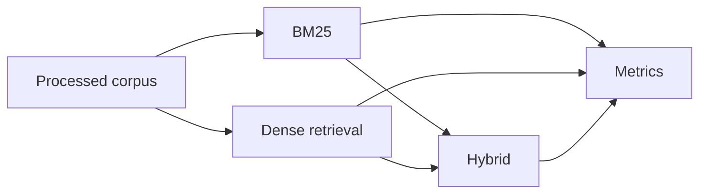

# Experiments and Evaluation Plan

The evaluation pipeline compares the retrieval strategies on the same query set and relevance labels so the results are directly comparable.



## Experiment 1: BM25 vs dense retrieval

This compares the lexical baseline against semantic retrieval and answers whether embedding-based retrieval improves ranking quality when query wording differs from the passage wording.

## Experiment 2: Dense vs hybrid retrieval

This measures whether score fusion improves ranking quality over dense retrieval alone. Hybrid retrieval is especially useful when some queries benefit from lexical overlap and others benefit from semantic similarity.

## Experiment 3: Hybrid weight sensitivity

The hybrid method uses an $\alpha$ parameter to control the lexical-semantic trade-off. The project keeps this value configurable so different settings can be compared systematically.

## Experiment 4: Embedding model comparison

If additional compute is available, alternative embedding models can be compared against the default BGE-small model. This is optional and not required for the base project.

## Reporting

The evaluation script prints a summary table and saves JSON outputs and plots under results/figures/.

```text
Method              Recall@10    MRR@10    NDCG@10
---------------------------------------------------
BM25
Dense
Hybrid
```

The values are produced by running the evaluation script on the configured dataset subset in config.yaml.

## RAG evaluation

The RAG pipeline is evaluated separately from the retrieval baselines:

- Context Recall@K: whether relevant qrel passages reach the generated context
- Context Precision@K: fraction of context passages judged relevant by qrels
- Retrieval, reranking, and optional generation latency
- Faithfulness and answer relevance lexical proxies when `--generate` is used

Run `python scripts/evaluate_rag.py` for context metrics, or add
`--generate` to call Ollama and record answer-level proxies. The proxies are
diagnostics, not semantic judge scores; human or model-based evaluation is
needed for a publication-quality faithfulness claim.
