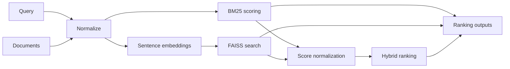
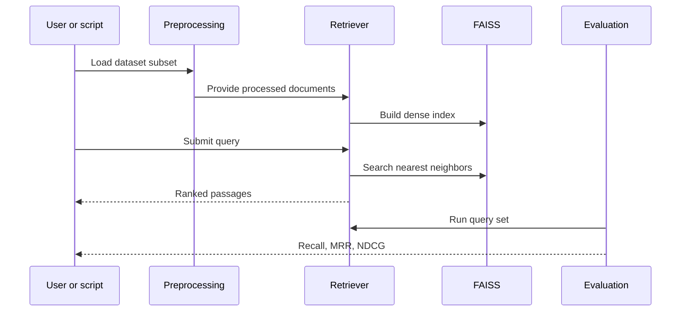

# Methodology

The methodology follows a standard retrieval workflow: normalize the text, build retrieval models, score candidate passages, fuse scores where needed, and evaluate with ranking metrics.

## 1. Lexical retrieval with BM25

BM25 is a term-based ranking model that combines term frequency, inverse document frequency, and document length normalization. It is effective when query wording overlaps with the passage text.

The project implements BM25 using the rank-bm25 package and exposes it as a reusable module.

## 2. Semantic retrieval with embeddings

Semantic retrieval represents both the query and each passage in the same vector space. Similar meanings tend to appear close together, even when the surface words differ.

The project uses the pretrained sentence-transformers model BAAI/bge-small-en-v1.5. Embeddings are normalized and generated in batches to keep the pipeline efficient on local machines.

## 3. Vector indexing with FAISS

The passage embeddings are inserted into a FAISS index for efficient nearest-neighbor search. The index is saved to disk so retrieval can be reused without recomputing embeddings on every run.

## 4. Hybrid retrieval

BM25 and dense retrieval produce scores on different scales. The project normalizes each score set before combining them.

Hybrid score:

$$
\alpha \cdot \text{normalized\_bm25\_score} + (1 - \alpha) \cdot \text{normalized\_semantic\_score}
$$

The weight $\alpha$ is configurable and can be tuned during evaluation.

## 5. Evaluation methodology

The system is evaluated against dataset relevance judgments using standard ranking metrics:

- Recall@K
- MRR@K
- NDCG@K

These metrics capture both retrieval coverage and ranking quality.

## 6. Implementation flow

## 7. Design outcome

The methodology keeps retrieval strategies comparable by evaluating them against the same documents, queries, and relevance labels. That makes it possible to isolate the effect of lexical matching, semantic matching, and score fusion.
